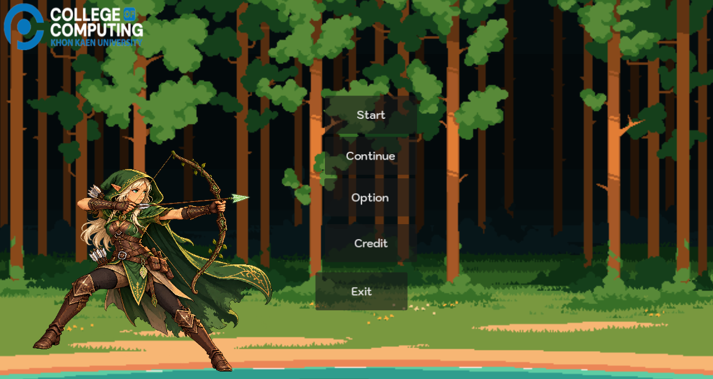
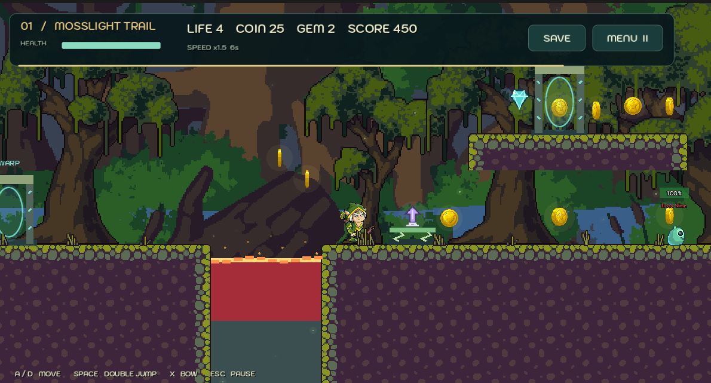

# 🎮 2D Platformer Starter Kit

## 📖 Story

ครั้งหนึ่ง ป่ามรกตเคยมี “หัวใจแห่งพงไพร” คริสตัลศักดิ์สิทธิ์ที่หล่อเลี้ยงต้นไม้และสรรพชีวิต แต่หลังแผ่นดินไหวครั้งใหญ่ หัวใจคริสตัลดับแสงลง กลไกโบราณใต้ป่ากลับทำงาน ใบมีดเริ่มหมุน ลาวาผุดขึ้นจากพื้น และสัตว์ตัวน้อยกลายเป็นผู้เฝ้าป่าที่ดุร้าย
เอริน เอลฟ์ฝึกหัดผู้ดูแลชายป่า ได้รับธนูมรกตที่แม่ทิ้งไว้ พร้อมข้อความสั้น ๆ ว่า
**“หากวันหนึ่งป่าเงียบงัน จงตามแสงหิ่งห้อยกลับไปยังบ้านของเรา”**
เอรินจึงออกเดินทางตามเส้นทางเก่าของแม่ เพื่อปลุกเสารูนทั้งสี่และนำแสงกลับสู่หัวใจแห่งพงไพร

## การควบคุม

| ปุ่ม | การทำงาน |
| --- | --- |
| A / D หรือ ลูกศรซ้าย–ขวา | เดิน / วิ่ง |
| Space / W / ลูกศรขึ้น | กระโดด กดซ้ำกลางอากาศเพื่อกระโดดสองครั้ง |
| X | ยิงธนู ปล่อยลูกธนูตามจังหวะแอนิเมชัน |
| Esc | หยุดเกม / เปิดเมนูพัก |
| SAVE | บันทึกด่าน ตำแหน่ง จุดพัก คะแนน ไอเทม และเวลาบัฟ |

## 🎥 ตัวอย่างการเล่น (Demo Video)

ดูวิดีโอเล่นเกม 👉 [คลิกเพื่อรับชม](https://drive.google.com/file/d/1KMrSJ6aXpzNk8_NOr_DJrHFlbciXlGk3/view?usp=sharing)

## 🕹️ ทดลองเล่นเกม

- [Game Preview](https://pong-45.github.io/gamedev2026-project/)

## 👤 ผู้จัดทำ

- **ชื่อ:** พีรพงษ์ ราษีทอง
- **รหัสนักศึกษา:** 673380334-5
